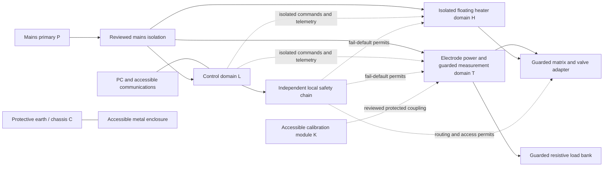

# Safety states, isolation and fault response

Revision 0.4 — 7 November 2026 — G3 **concept for independent review**; G1-06 microphonics, G2-07 internal-load-bank and G2-09 concurrent-path implications included.

Trace: R005,R028,R036,R049–R060,R069–R070; D009,D011–D016,D021. No clearance, creepage, withstand rating, component value, safe-access voltage or response time is assigned here. These require the environment, boundary stresses and applicable safety review first.

## Safety design basis still open

Candidate standards for the reviewer are IEC 61010-1 for this class of equipment and IEC 61010-2-030 for external testing/measuring circuits. The public IEC scope pages support considering them; their full requirements, applicable editions/national adoptions and any additional standards have **not** been reviewed. No compliance claim follows from these references. [IEC 61010-1 scope](https://webstore.iec.ch/en/publication/59769), [IEC 61010-2-030 scope](https://webstore.iec.ch/en/publication/75915).

Before deriving insulation or access limits, record intended users/use, regional markets, bench/portable installation, indoor/outdoor exposure, mains range and overvoltage environment, maximum altitude, ambient/humidity/condensation, pollution degree, material group/CTI, enclosure/earthing class, accessible socket/fixture/calibration surfaces, foreseeable misconnection and external energy sources. None is silently set to a customary value. Identify the independent reviewer and required tests under D013.

G2-05 establishes 0–40 °C ambient as a power/thermal requirement; humidity, altitude and other safety-environment conditions remain Open. G2-07 prefers the main-unit resistive bank internally, with placement Provisional. Internal packaging retains guard/access, temperature, discharge and return/isolation review requirements; the load-power area must remain appropriately separated from precision circuitry. No construction dimension or temperature threshold is inferred.

The insulation review must distinguish working voltage, peak/RMS voltage, transients and insulation function at every boundary. Creepage and clearance depend on different stress/environment factors; fabrication minimum spacing is not a safety spacing rule. This is consistent with [TI's isolation guidance](https://www.ti.com/video/6146024211001), but project dimensions require the selected end-equipment assessment.

## Proposed functional domains

This diagram is a candidate isolation partition, not a selected converter topology. Multiple power barriers may be needed; “reviewed mains isolation” does not declare one shared transformer adequate. The final relation between T reference and chassis is Open. Low-voltage electronics in T can be at hazardous common mode and are not automatically accessible. A quiet analog subdomain within T is a return-current partition, not a safety barrier by itself.

| Boundary | Stress / paths requiring review | Proposed disposition; all numeric ratings TBD |
|---|---|---|
| P ↔ L, T, H, chassis | Mains working/transient/fault voltage, transformer and auxiliary paths | Reviewed insulation plus protective measures under selected equipment class |
| T ↔ L/PC | T common mode, anode/grid/screen faults, digital isolator and DC/DC paths | Isolate all command, measurement and power crossings; connector shields must not bypass barrier |
| H ↔ T | Heater reference elevation, AC differential peak, H–K faults, DHT reference path | Floating supply; intentional reference connection only in verified safe configuration; rating from D009 |
| H ↔ L/chassis | Maximum positive/negative heater float plus waveform/transients | Independent boundary review; a 50 V differential label gives no float rating |
| Anode ↔ grid/screen/cathode within T | Example +600 to −150 V = 750 V difference; fault/backfeed can alter it | Insulation/functional separation and routing rules derived for each pair, including socket surfaces |
| T/H ↔ adapter pins/guard | Energized socket contacts, exposed/unmated/partially mated connectors, residual charge | Guarded access with retained access lock or equivalent reviewed means; mechanical base is not proof of spacing |
| T ↔ load-power area X | HV on internal resistor terminals, possible backfeed, cooling/sense returns and heat near other circuits | G2-07 preferred internal placement Provisional; reviewed internal barriers/connections, local discharge/temperature sensing and guarded service access; separate PIV fixture unchanged |
| T ↔ calibration module K | Possible HV entering accessible standards, faulty calibration switch, external instrument earth | Protected/isolation-controlled calibration path and mode interlock; no bare live reference port |
| Chassis ↔ signal references / cable shields | PE integrity, earth loops, parasitic capacitance and leakage current | Intentional documented bonds only; PE neither switched nor used as operating current return in candidate Class I design |

Measurement instruments and debug cables are additional boundary crossings. Use probes/instruments rated for differential **and** common-mode stresses; preserve protective earth. A conventional oscilloscope's common is usually earth-connected and can short a floating node. [Tektronix floating-measurement guidance](https://download.tek.com/document/51W_10640_1.pdf).

## Permission model

Proposed independent permits:

- `ENERGY_PERMIT`: local hard protections healthy, guarded access secured, watchdog/lease valid, adapter/map/profile accepted and power reservation valid. Removing any necessary condition inhibits energy without PC action.
- `ROUTE_PERMIT`: every relevant energy source inhibited, no external backfeed, all reachable/trapped storage nodes verified below reviewed limits for a specified dwell, monitors healthy and the energy permit physically blocked. Firmware cannot assert both permits.
- `ACCESS_PERMIT`: electrical safe-state evidence plus any thermal/access criteria; logical permission cannot substitute for a mechanism that prevents a guard being opened while charge remains.

Default on missing power/wire/status is **no permission**. A single shared ADC, reference, firmware loop or control output must not be the sole arbiter of both energization and “safe to touch.” Independence, diagnostics and common-cause failure coverage need S review; the diagram alone does not demonstrate them.

“Safe routing state” proposal: all source-to-socket connections open, all outputs inhibited, and every segment given a defined discharge path independent of the current routing map. Intentional reference and source changes occur only under ROUTE_PERMIT. All-open is not evidence that a socket pin has discharged. Monitor both converter-side and isolated socket-side capacitances, and reject a welded contact or uncertain state before energization.

Power loss can release contacts while energy still exists. The matrix design must either retain paths long enough to discharge or safely interrupt the reviewed fault energy while leaving each isolated segment dischargeable. A command prohibition cannot solve this mechanical fault case. Switching technology and discharge arrangements remain D012/D014; no relay rating or latching arrangement is selected.

## State diagram

```mermaid
stateDiagram-v2
  [*] --> OFF_UNKNOWN
  OFF_UNKNOWN --> BOOT_INHIBITED: local power returns
  BOOT_INHIBITED --> DISCHARGING: outputs blocked; monitors initialize
  DISCHARGING --> SAFE_VERIFIED: all node limits and dwell met; diagnostics valid
  DISCHARGING --> LOCKED_UNKNOWN: timeout or invalid discharge evidence
  SAFE_VERIFIED --> CONFIGURING: access closed; routing permit
  CONFIGURING --> ARMED: map verified; routing permit removed
  CONFIGURING --> DISCHARGING: abort or invalid map
  ARMED --> DIAGNOSTIC: approved bounded cold-check stimulus
  DIAGNOSTIC --> DISCHARGING: checks complete or abort
  ARMED --> HEATER_WARMUP: profile permits; cold checks current
  HEATER_WARMUP --> TEST_ACTIVE: bias and electrode sequence verified
  TEST_ACTIVE --> NORMAL_STOP: test done or user stop
  HEATER_WARMUP --> NORMAL_STOP: user stop
  NORMAL_STOP --> DISCHARGING: all generating paths inhibited
  ARMED --> FAULT_INHIBITED: loss of any required permit
  DIAGNOSTIC --> FAULT_INHIBITED: fault
  HEATER_WARMUP --> FAULT_INHIBITED: fault
  TEST_ACTIVE --> FAULT_INHIBITED: fault
  NORMAL_STOP --> FAULT_INHIBITED: fault
  CONFIGURING --> FAULT_INHIBITED: monitor/interlock fault
  FAULT_INHIBITED --> DISCHARGING: independent discharge active; latch retained
  SAFE_VERIFIED --> BOOT_INHIBITED: explicit reset after cleared fault
  SAFE_VERIFIED --> OFF_UNKNOWN: power removed
  LOCKED_UNKNOWN --> BOOT_INHIBITED: controlled service recovery only
```

Global transitions omitted for diagram clarity: any state losing local control power goes to OFF_UNKNOWN electrically, with generation inhibited and power-independent discharge behavior required; power restoration always enters BOOT_INHIBITED. Any contradictory safety indication enters FAULT_INHIBITED or LOCKED_UNKNOWN, never SAFE_VERIFIED. SAFE_VERIFIED with a fault latch cannot enter CONFIGURING until explicit reset/revalidation. No PC reconnect, guard closure or timeout automatically restarts a test.

| State | Outputs / references | Routing / access |
|---|---|---|
| OFF_UNKNOWN / BOOT_INHIBITED | Generators disabled by default; passive/fail-powered discharge must function | No asserted safe state; no commanded routing; access remains guarded |
| DISCHARGING / FAULT_INHIBITED | Energy generation blocked; local discharge; fault latch retained | No user reconfiguration or access permission |
| LOCKED_UNKNOWN | Inhibit and discharge attempts maintained where available; uncertain node treated as energized | Access/routing denied; qualified recovery procedure required |
| SAFE_VERIFIED | All outputs and diagnostic stimulus off; residual differential/common-mode energy verified | Access permitted only if thermal criteria also met; configuration needs guard closed |
| CONFIGURING | Energy permit blocked; permitted references/map set and low-energy contact verification performed | Break-before-make/settling/readback contract TBD; intentional routing only here |
| ARMED | Static approved map; no energy yet | Guard locked; routing blocked |
| DIAGNOSTIC | Only approved current/energy-limited stimulus enabled; HV/heater blocked unless an explicit hot-test profile applies | Guard closed; routing fixed; return via discharge before map changes |
| HEATER_WARMUP | Bounded heater ramp and valid reference; bias prepared; electrode permits sequenced | Routing locked; warmup interval/settling profile-specific |
| TEST_ACTIVE | Reserved setpoints within independent rail limits and valve-specific limits | Routing and reference topology locked |
| NORMAL_STOP | Stop stimulus; remove screen/anode in valve-safe order; preserve bias as needed until their stored energy falls; heater then off | Guard/routing locked throughout; transitions to discharge verification |

On a fault, rapid source inhibition and reviewed energy isolation override the normal ramp sequence. Bias retention can assist shutdown but must not be the only protection against anode/screen conduction during bias-supply failure. Any remaining negative grid charge is itself included in the discharge/access checks. Screen disable must not depend on a PC noticing anode loss.

## Fault-response table

All deadlines below are **TBD by D014/D015**, derived from maximum tolerable device/fault energy, then measured. “Immediate local” means independent of the PC; it does not claim zero latency.

| Event / fault | Independent detection / coverage needed | Required response and final state | Verification evidence |
|---|---|---|---|
| Startup / brownout / reset | Power-good, reset-qualified permits | Outputs inhibited; BOOT_INHIBITED → discharge check; no retained run command | Ramp/interrupt each supply in every state; measure unintended pulse energy |
| Normal test completion / stop | Local sequencer validates state | Controlled rail sequence → discharge → SAFE_VERIFIED | Traces of bias, screen, anode, heater and access/routing permits |
| PC disconnect / hung host / stale commands | Local expiring lease/watchdog; traffic alone not proof of valid command | Remove energy permission; fault latch; discharge; reconnect requires reset | Cable pull, frozen heartbeat counter, replay and corruption |
| Local controller crash / stuck output | Independent watchdog and hard permit chain | Energy cutoff without firmware; discharge with loss of controller supply | Halt controller, force command output high/low; quantify response |
| Guard/interlock opens or cable disconnects | Local interlock circuit with fault diagnostics | Inhibit all energy; maintain physical access restriction while charge decays | Open/short/stuck switch and broken wire; evaluate guard defeated in one fault |
| Overcurrent / short at any output | Local rail current limit/trip; independent energy bound | Limit/trip within derived energy; disable dependent rails; latch and discharge | Short at converter and socket; worst capacitance and line/load |
| Aggregate overpower / invalid reservation | Local independent limit enforcement and actual-demand supervision | Refuse start or trip; do not silently derate a measured test | Requests at either side of limits, sensor error and actuator fault |
| Grid bias absent/wrong polarity / anode loss | Local bias-valid and rail-valid checks | Block or cut anode and screen; no dependence on PC polling | Bias supply removed; anode opened/shorted; screen current transient |
| Regulator/pass switch short or stuck enabled | Independent series energy isolation or equivalent reviewed second barrier | Stop upstream energy, discharge downstream; ordinary enable pin alone insufficient | Single element short modeled/injected safely; prove finite residual fault energy |
| Heater H–K fault / reference switch fault | Leakage/reference plausibility, current imbalance, independent limits | Inhibit heater and electrode energy; preserve fault isolation; discharge | H–K short, reference open/short/wrong node, DHT return faults |
| Matrix contact weld / failed crosspoint / wrong adapter | Identity, map readback and low-energy electrical verification | Refuse enable; inhibit if detected live; account for backfeed/trapped charge | Weld/open model, crossed pins, simultaneous source paths, missing adapter |
| Voltage/current sensor open/short/stuck-low | Independent checks, redundancy/diversity as required | Invalid indication cannot grant safe access or energization | Disconnect sensor/reference, force zero/full scale; trace permits |
| Discharge element open / switch failed / persistent backfeed | Independent residual monitors at every isolated storage segment | Remain LOCKED_UNKNOWN past timeout; no unlock or reconfiguration | Open dump path, retained charge behind contacts, external source injection |
| Discharge element short | Current/thermal protection and separation | Prevent uncontrolled source stress; inhibit; keep accessible parts protected | Shorted dump branch under worst feed and loss-of-control case |
| Mains removal while charged | Power-loss default and discharge independent of main control | Source off; decay without PC; unknown until independently verified | Unplug at worst stored energy; test with control power absent |
| Fan failure / blocked airflow / overtemperature | Local temperature sensors, fan feedback where applicable | Derate only if approved policy; otherwise stop and discharge; retain thermal guard | Fan stopped, airflow blocked, sensor open/short; hottest locations |
| Sense lead broken / compensation saturates | Local sense plausibility and voltage ceiling | No runaway from remote-sense loss; inhibit and discharge | Open/short Kelvin leads individually; terminal voltage trace |
| Measurement/calibration path receives HV | Protected boundary, range/overload diagnostics | Contain fault; inhibit; protect external connector/PC | Single switching/attenuator fault and misplug; isolation review |
| PE or insulation fault | Protective arrangement under chosen class; not just software | Accessible parts remain protected by reviewed measures; local monitoring if required | Approved continuity, insulation/leakage and single-fault procedures |

Each fault is assessed individually and for common-cause dependencies; this is a starting fault list, not an exhaustive FMEA. No prototype is energized until the relevant fault response has a numerical acceptance contract and a safe test method.

G2-09 adds explicit concurrent comparison paths alongside selectable sequential operation. Expand the normal/start/stop/link-loss/interlock/overload/short/single-fault review across all active paths and any shared supply, heater, cathode/reference or load connection. Review cross-channel backfeed, an energized peer driving a disabled path, incorrectly attributed fault/sense data and shared stored energy. Define which coupled paths must shut down together; exact containment and timing remain Open. Access and routing permission must account for every relevant energized/storage node, and sequential mode does not authorize switching a live matrix. No per-channel power or insulation rating follows from this scope choice.

## Review contract

G1-06 requires D022 to cover microphonics fixture/stimulus behavior within this safety architecture. The selected method must preserve guarded access and isolation during an energized test. Define its permitted test state, startup/stop behavior, communications-loss and open-interlock response, and any powered-drive overload, short or single-fault response before implementation. A manual stimulus mechanism also needs a reviewed means of applying the stimulus while retaining the guard. No actuator, mechanical force, insulation distance or timing value is chosen here.

**Established:** local protection, no energized intentional rerouting, monitored discharge and PC independence come from agreed requirements. **Proposed:** domains, independent permits, retained guarded access, fail-latched restart and segmented discharge. **Open:** D009,D011–D016,D021; timing, energy, environment and physical independence remain unverified.

**Verification plan:** state-transition and fault injection at limited energy first; independent measurements of every storage node; loss-of-power discharge; guard and sensor faults; then staged full-envelope testing after review. Inspect current returns and every unintended PC/debug/calibration isolation bypass.

**Pass G3 only when:** an independent reviewer accepts the design basis, boundary stresses, protective architecture and single-fault analysis; numeric trip/discharge/access criteria and test methods are approved; normal and fault rail sequencing is defined; no unresolved path can energize an accessible part or silently permit routing.
